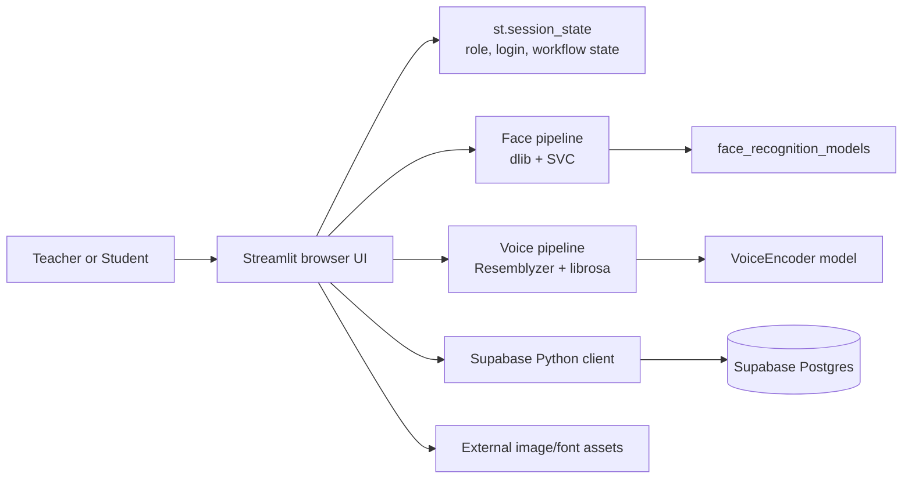
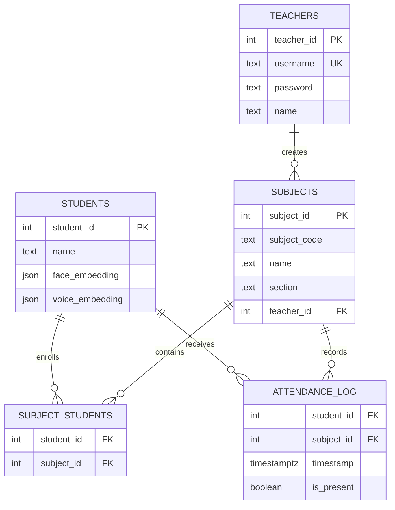

# SnapClass

> **AI-assisted classroom attendance for teachers and students.**
>
> SnapClass reduces the friction of taking attendance by recognizing students from
> classroom photos or recorded classroom audio, then letting a teacher review and
> save the result against a subject.

[](https://www.python.org/)
[](https://streamlit.io/)
[](https://supabase.com/)

## What the project does

SnapClass provides two role-based experiences:

- **Teachers** register and sign in with a username and bcrypt-hashed password,
  create subjects, share a subject code or QR link, run face or voice attendance,
  review the detected roster, and inspect attendance summaries.
- **Students** register with a camera-captured face profile, optionally enroll a
  voice profile, sign in with FaceID, join subjects using a code or shared link,
  and view attendance statistics for enrolled subjects.

The application is deployed as a Streamlit app and currently uses Supabase's
Python client directly from the Streamlit process. There is no separate
FastAPI/Flask service or custom REST controller in this repository.

## Architecture and high-level design

### System flow



### Architectural pattern

SnapClass is a **single-process, UI-driven monolith** organized into functional
modules:

| Layer | Location | Responsibility |
| --- | --- | --- |
| Application entry point | [`app.py`](app.py) | Configures Streamlit, selects the current role, and handles `join-code` query links. |
| Screens | [`src/screens/`](src/screens/) | Implements home, teacher, and student workflows. |
| Components | [`src/components/`](src/components/) | Encapsulates dialogs, cards, headers, footers, enrollment, sharing, and attendance review. |
| Domain/data access | [`src/database/db.py`](src/database/db.py) | Performs Supabase queries and bcrypt password operations. |
| ML pipelines | [`src/pipelines/`](src/pipelines/) | Extracts face/voice embeddings and performs recognition. |
| UI styling | [`src/ui/base_layout.py`](src/ui/base_layout.py) | Applies Streamlit CSS and page themes. |

Streamlit reruns the script on interaction. `st.session_state` is therefore used
as the short-lived application state machine: it stores the active role, logged-in
teacher/student record, selected teacher tab, uploaded photos, and pending
attendance review results.

## Technology stack

### Frontend and presentation

| Technology | Use |
| --- | --- |
| Streamlit | Python-native reactive UI, dialogs, forms, camera/audio capture, data tables, and session state. |
| Streamlit CSS/HTML | Custom themes, typography, buttons, cards, and layout in [`src/ui/base_layout.py`](src/ui/base_layout.py) and [`src/components/`](src/components/). |
| `Pillow` | Opens camera and uploaded image files before NumPy conversion. |
| `segno` | Generates QR codes for shareable subject links. |

There is no separate JavaScript frontend or client-side state-management library;
the browser UI is rendered and coordinated by Streamlit.

### Backend and application runtime

| Technology | Use and rationale |
| --- | --- |
| Python 3.10.11 (development virtual environment) | Runtime for UI, data access, and ML workflows. |
| Streamlit | Serves the application and provides the interaction lifecycle. |
| `bcrypt` | Hashes teacher passwords with a per-password salt and verifies login attempts. |
| `st.session_state` | Maintains role and workflow state across Streamlit reruns. |

Authentication is application-level rather than JWT/OAuth-based: teachers use
username/password, while students are recognized from a face embedding. The
current implementation does not issue tokens or maintain a server-side session
store.

### Database, storage, and ML

| Technology | Use |
| --- | --- |
| Supabase Postgres | Stores teachers, students, subjects, enrollments, and attendance logs. |
| Supabase Python client | Provides table queries, inserts, and deletes in [`src/database/db.py`](src/database/db.py). |
| `dlib` + `face_recognition_models` | Detects faces and generates 128-dimensional face descriptors. |
| `scikit-learn` `SVC` | Trains a linear, class-balanced classifier over stored face embeddings. |
| `Resemblyzer` + `librosa` | Converts recorded audio into 16 kHz voice embeddings and segments bulk classroom audio. |
| NumPy / pandas | Represents embeddings and builds attendance result and summary tables. |

Embeddings are persisted in the `students` table as arrays/JSON-compatible
values. The application caches heavyweight model initialization and the trained
face classifier with `st.cache_resource`.

### DevOps and tooling

| Tool | Current role |
| --- | --- |
| `pip` + [`requirements.txt`](requirements.txt) | Dependency installation. |
| Python virtual environment | Local isolation; the repository's environment is Python 3.10.11. |
| Streamlit deployment | The share-link builder targets `snapclass-mainasad.streamlit.app`. |
| Git | Source control. |

No Dockerfile, CI workflow, infrastructure-as-code, formatter/linter
configuration, or automated test directory is present in the repository.

## Key engineering highlights and interview talking points

### 1. Reviewable, multi-image attendance

Teachers can capture or upload multiple classroom photos. Each image is converted
to face embeddings, recognized students are accumulated across all images, and the
result is converted into a full enrolled-roster table containing both present and
absent students. Attendance is not written immediately: the teacher can discard
or confirm the generated log in [`dialog_attendance_results.py`](src/components/dialog_attendance_results.py).

**Trade-off:** keeping images and pending logs in Streamlit session state makes the
workflow simple and reviewable, but it is process-local and not suitable for
multi-replica coordination without external state.

### 2. Cached model loading and classifier rebuilds

`dlib` models, the Resemblyzer encoder, and the trained face classifier use
`st.cache_resource` so expensive model initialization does not happen on every
rerun. After a student registers, `train_classifier()` clears the resource cache
so the new face profile is included.

**Trade-off:** cache invalidation is deliberately coarse. It keeps the code
simple, but a larger deployment should use a versioned model artifact and an
explicit retraining job rather than rebuilding inside a user interaction.

### 3. Two recognition modalities with different matching strategies

Face recognition uses a linear SVM when at least two known identities are
available and a direct single-identity fallback otherwise. A Euclidean distance
threshold of `0.6` filters face matches. Voice attendance uses cosine-style dot
product similarity with a `0.65` threshold, processes speech segments at least
0.5 seconds long, and retains the highest score per student.

**Trade-off:** these lightweight thresholds provide an interactive prototype
without a separate inference service, but production use would require calibration
against a representative dataset, liveness/anti-spoofing controls, and audit
metrics for false accepts and false rejects.

### 4. Relational enrollment and attendance aggregation

Subjects and students are connected through the `subject_students` join table.
Attendance is recorded per student, subject, and timestamp, allowing the teacher
view to group a session by timestamp and calculate present/total counts while the
student view calculates per-subject totals and attended sessions.

**Trade-off:** storing one row per student per session makes reporting simple and
auditable, but a high-volume system would need indexes, session identifiers, and
possibly an asynchronous aggregation path.

## API and data operations

### Application API boundary

This repository does **not** expose custom REST or GraphQL routes. User actions
are Streamlit callbacks, and persistence is performed through the Supabase
Python SDK. The table below documents the primary logical operations (and their
Supabase PostgREST equivalent) so the data boundary remains explicit.

| Method | Route / operation | Request body or parameters | Expected result |
| --- | --- | --- | --- |
| `POST` | `teachers` insert | `{ "username", "password", "name" }`; password is bcrypt-hashed before insert | Inserted teacher row; UI switches to login |
| `GET` | `teachers?username=eq.<username>` | Username lookup during login or uniqueness check | Matching teacher row or empty result |
| `POST` | `students` insert | `{ "name", "face_embedding", "voice_embedding" }` | Inserted student profile; face classifier cache is refreshed |
| `POST` | `subjects` insert | `{ "subject_code", "name", "section", "teacher_id" }` | Inserted subject row |
| `GET` | `subjects?teacher_id=eq.<teacher_id>` | Teacher ID; includes enrollment counts and attendance timestamps | Teacher subject cards and class statistics |
| `GET` | `subjects?subject_code=eq.<code>` | Subject code from a dialog or `?join-code=` link | Subject metadata or “not found” |
| `POST` | `subject_students` insert | `{ "student_id", "subject_id" }` | Enrollment row; duplicate enrollment is checked in the UI |
| `DELETE` | `subject_students?student_id=eq.<id>&subject_id=eq.<id>` | Student and subject IDs | Deleted enrollment row |
| `POST` | `attendance_log` insert | One row per enrolled student: `{ "student_id", "subject_id", "timestamp", "is_present" }` | Saved attendance session after teacher confirmation |
| `GET` | `attendance_log` query | Student ID, or inner join through `subjects.teacher_id` for a teacher | Student history or teacher attendance records |

The SDK calls are implemented in [`src/database/db.py`](src/database/db.py);
the lower-level Supabase REST URL and API key are managed by Supabase and should
not be hard-coded in application source.

## Database schema and data model

The following model is inferred from the queries and payloads in
[`src/database/db.py`](src/database/db.py):



The subject/student relationship is many-to-many through `subject_students`.
`attendance_log` is intentionally denormalized at the event level: every enrolled
student receives a row for each attendance session, including absences.

## Getting started

### Prerequisites

- Python 3.10 or newer (Python 3.10.11 is the version used by the checked-in
  development environment).
- A Supabase project with the tables and relationships described above.
- A working C/C++ build environment may be required by `dlib-bin` on platforms
  where a compatible wheel is unavailable.
- A browser with camera and microphone permissions for face and voice flows.

### Configure Supabase secrets

The application reads secrets through `st.secrets` in
[`src/database/config.py`](src/database/config.py), not through `python-dotenv`.
Create `.streamlit/secrets.toml` locally (the directory is gitignored):

```toml
SUPABASE_URL = "https://<project-ref>.supabase.co"
SUPABASE_KEY = "<supabase-anon-or-service-key>"
```

`SUPABASE_URL` identifies the project. `SUPABASE_KEY` is the key used by the
Supabase Python client; keep it out of source control and never paste a real key
into documentation or issue reports.

### Install and run

```powershell
# From the repository root
py -3.10 -m venv .venv
.\.venv\Scripts\Activate.ps1
python -m pip install --upgrade pip
python -m pip install -r requirements.txt

# Start the Streamlit application
python -m streamlit run app.py
```

Streamlit will print a local URL, normally
`http://localhost:8501`. Open it in a browser and choose the Teacher or Student
portal. A teacher can share a subject using a URL shaped like:

```text
https://snapclass-mainasad.streamlit.app/?join-code=<SUBJECT_CODE>
```

### Supabase setup expectations

Before using the workflows, create the tables/foreign keys represented in the
schema diagram and ensure the Supabase client has permission to read/write them.
The code expects the `subjects` query to expose related `subject_students` counts
and `attendance_log` timestamps, and expects nested `students`/`subjects`
relations for enrollment and attendance queries.

## Testing and code quality

There is currently no `tests/` directory, test runner configuration, CI workflow,
or lint configuration in the repository. The following commands provide a useful
baseline for local verification:

```powershell
# Syntax/import compilation check for first-party Python files
python -m compileall -q app.py src

# Run the application smoke test manually
python -m streamlit run app.py
```

Recommended manual smoke-test paths:

1. Register and log in as a teacher.
2. Create a subject and verify the subject card and share dialog.
3. Register a student with a camera image, optionally with audio.
4. Enroll the student using the code and using a `join-code` link.
5. Run face attendance, review the generated roster, confirm it, and check the
   teacher records and student statistics.
6. Run voice attendance with enrolled voice profiles.

For production readiness, add unit tests around `src/database/db.py` and the
recognition pipelines, integration tests against a disposable Supabase project,
and an end-to-end browser suite for the camera/upload, enrollment, and
confirm-save flows.

## Future scalability improvements

For a deployment serving 100k+ users, the next engineering steps would be:

1. **Separate web and inference workloads.** Keep Streamlit as a presentation
   layer or replace it with a conventional frontend/API, then move face/voice
   inference to a queue-backed worker service. This prevents CPU-heavy model
   work from blocking interactive sessions.
2. **Introduce durable job and session state.** Store uploads in object storage,
   persist attendance jobs and review state in Postgres, and use Redis for
   short-lived workflow state and rate limiting instead of relying on one
   Streamlit process.
3. **Index the relational access paths.** Add/verify indexes and uniqueness
   constraints for `teachers.username`, `subjects.subject_code`,
   `(student_id, subject_id)` in `subject_students`, and
   `(subject_id, timestamp)` / `(student_id, timestamp)` in `attendance_log`.
4. **Version and govern embeddings.** Store model version, embedding dimension,
   capture metadata, and consent/audit records. Re-enroll or migrate embeddings
   when the recognition model changes.
5. **Harden identity and privacy.** Replace face-only student login with an
   explicit account or magic-link identity, add liveness detection, apply row
   level security and least-privilege keys, encrypt sensitive biometric data,
   and define retention/deletion policies.
6. **Improve reporting.** Add a stable attendance-session ID, materialized
   aggregates or scheduled summaries, pagination, and export jobs so large
   attendance histories do not require loading an entire table into pandas.
7. **Add operational controls.** Containerize reproducible ML dependencies,
   add CI for formatting/type checks/tests, collect structured logs and model
   quality metrics, and deploy multiple stateless replicas behind a managed
   service.

## Repository layout

```text
.
├── app.py
├── requirements.txt
├── src
│   ├── components       # Streamlit dialogs and reusable UI components
│   ├── database         # Supabase client and data-access functions
│   ├── pipelines        # Face and voice recognition
│   ├── screens          # Home, teacher, and student workflows
│   └── ui               # Shared layout and CSS
└── .streamlit
    └── secrets.toml     # Local-only Supabase credentials (gitignored)
```

## Security and privacy note

Face and voice embeddings are biometric-derived data. Treat them as sensitive
personal information: use least-privilege Supabase policies, protect secrets,
restrict access to production tables, obtain appropriate consent, and implement
retention/deletion controls before using SnapClass with real classrooms.
